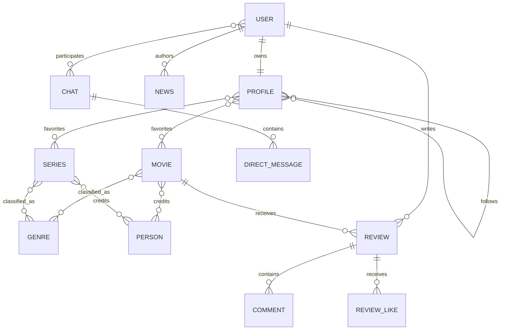

# Movix API

[](https://github.com/adskiydrochila54/MovieSocial/actions/workflows/ci.yml)

Movix is a portfolio-ready REST API for discovering movies and series, publishing reviews,
following other users and having private conversations. It demonstrates a production-oriented
Django/DRF architecture rather than a collection of isolated CRUD endpoints.

## Highlights

- JWT authentication with rotating refresh tokens and logout blacklisting
- one canonical movie catalog with genres, people, movies and series
- reviews, nested comments and unique likes
- profiles, favorites and follow/unfollow actions
- published news with private author drafts
- participant-only direct messages and read status
- object-level permissions for user-owned content
- pagination, filtering, search and ordering
- OpenAPI, Swagger UI and ReDoc
- PostgreSQL, Gunicorn and Nginx in Docker Compose
- 20 API/security tests with more than 85% coverage
- Ruff, migration checks and pytest in GitHub Actions

## Stack

Python 3.12, Django 5.2, Django REST Framework, SimpleJWT, django-filter,
drf-spectacular, PostgreSQL 17, Gunicorn, Nginx, Docker Compose, pytest and Ruff.

## Architecture



Applications are separated by responsibility:

- `users` — authentication, public/private user representations, profiles and social graph
- `movies` — canonical catalog and credits
- `reviews` — reviews, comments and likes
- `news` — published posts and author-only drafts
- `direct_messages` — private chats and messages
- `core` — settings, health check and root routing

## Quick start with Docker

Requirements: Docker Desktop with Docker Compose.

```bash
cp .env.example .env
docker compose up --build
docker compose exec django python manage.py seed_demo
```

Open:

- Swagger UI: <http://localhost:8000/api/swagger/>
- ReDoc: <http://localhost:8000/api/redoc/>
- Admin: <http://localhost:8000/admin/>
- Health check: <http://localhost:8000/health/>

Before any public deployment, replace both secrets in `.env` and enable HTTPS redirects.

## Local development

```bash
python -m venv .venv
# Linux/macOS: source .venv/bin/activate
# Windows: .venv\Scripts\activate
python -m pip install -r requirements-dev.txt
python manage.py migrate
python manage.py seed_demo
python manage.py runserver
```

SQLite is used by default for local development. Set `DB_ENGINE=postgresql` and the
`POSTGRES_*` variables to use PostgreSQL outside Docker.

## API overview

All business endpoints are versioned under `/api/v1/`.

| Area | Endpoints |
| --- | --- |
| Auth | `/auth/register/`, `/auth/login/`, `/auth/refresh/`, `/auth/logout/` |
| Users | `/users/`, `/users/me/`, `/profiles/`, `/profiles/{id}/follow/` |
| Catalog | `/genres/`, `/people/`, `/movies/`, `/series/` |
| Community | `/reviews/`, `/comments/`, `/review-likes/`, `/news/` |
| Messages | `/chats/`, `/messages/`, `/messages/{id}/mark-read/` |

List endpoints accept page-based pagination. Catalog and community resources support
`search`, `ordering` and resource-specific filters documented in Swagger.

Example authentication:

```bash
curl -X POST http://localhost:8000/api/v1/auth/login/ \
  -H "Content-Type: application/json" \
  -d '{"email":"demo@movix.local","password":"DemoPass123!"}'
```

## Quality checks

```bash
ruff check .
python manage.py check
python manage.py makemigrations --check --dry-run
python manage.py spectacular --file schema.yml --validate
pytest --cov --cov-report=term-missing
```

The test suite focuses on authentication, ownership boundaries, private resources,
catalog write permissions, duplicate reviews/likes, draft visibility and chat membership.

## Security notes

- passwords are validated and stored only through Django's password hashing API;
- email is returned only by the authenticated `/users/me/` endpoint;
- exact birth dates are write-only; public profiles expose calculated age;
- object owners or staff control mutable user-generated content;
- unpublished news and direct messages use restricted querysets;
- secrets, hosts, CORS, CSRF and database credentials come from environment variables;
- production cookies, HSTS and proxy HTTPS handling are configured when debug mode is off.
